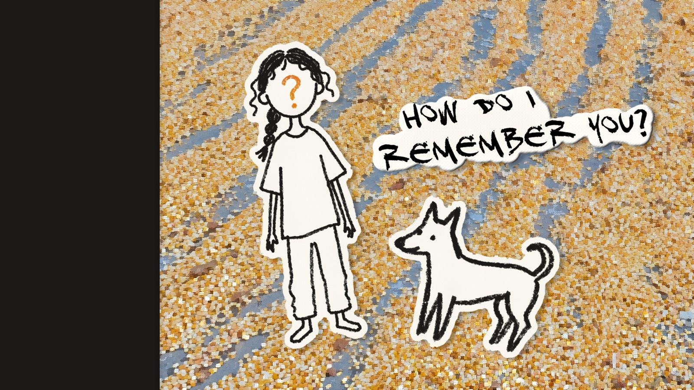
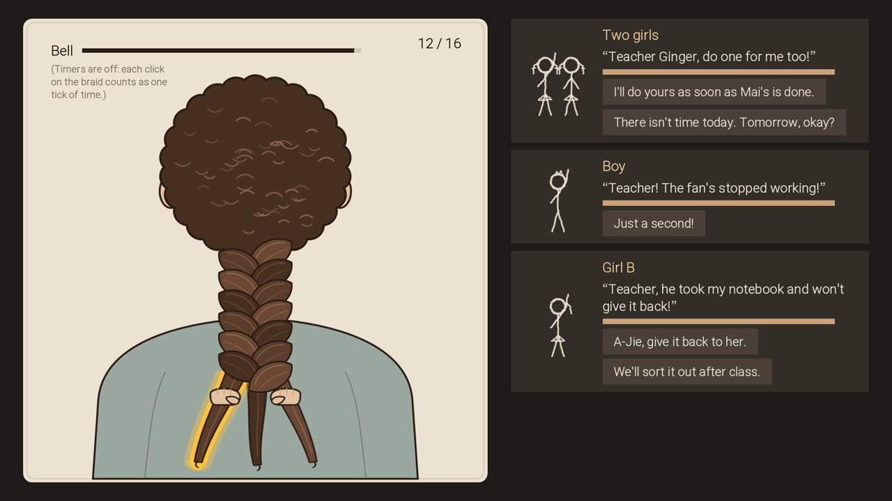

**English** · [中文](README.zh-CN.md)

# How Do I Remember You

*An interactive visual novel about a summer of volunteer teaching in a mountain village, and a girl named Mai.*

### [▶ Play it in your browser](https://paprikachen.github.io/how-do-I-remember-you/)

Free · about 40 minutes · English / 中文 · made with Ren'Py

---

## About

You are a university student who has signed up to teach at a village school deep in the mountains for the summer. You expected something like a summer camp. Instead, you sleep on the floor of a classroom with twenty other teachers, and on the first evening you meet **Mai**: a thin, sharp-eyed girl the other kids keep their distance from.

You want to help her. But you are an outsider who will leave in thirty days, and every time you step in, Mai or the village pays some of the cost.

The game asks two questions and does not answer them:

- **How far should an outsider step in?** Whether to film, whether to intervene, whether to tell the truth, what to leave behind.
- **What do these days mean to each of you?** Should you give yourself to the moment and grow close to her, knowing you will go back to your own life? Or hold back, and risk her never feeling taken seriously?

## How it plays

- **Three inner voices.** *The Teacher*, *The Passerby* and *The Lens* argue in your head at every key moment. None of them is the right one.
- **Hidden trust.** There is no meter on screen. Mai shows you how she feels by what she calls you, whether she comes to find you, and whether she keeps the braid you made her.
- **A camera you may never use.** You brought a camera to make a documentary about the summer. What you choose to film comes back at the end, clear and far away. What you didn't film survives only as fragments.
- **A countdown.** A small calendar in the corner counts the days you have left.
- **Small hands-on scenes.** Braid Mai's hair while other students tug at your sleeve. Frame and shoot photos through a viewfinder. Chat with her on your phone after you've gone home.

## The world

The backgrounds come from photos taken on a real volunteer-teaching trip: cornfields, the river bend, plum trees in Mai's yard. The characters are drawn in a deliberately simple, hand-made style.

Your choices lead to different goodbyes. Depending on how much Mai trusts you and what you leave her, she might run after the car, wave from the village gate, or not come out at all.

## This repository

This repository holds the Ren'Py web build that runs on GitHub Pages. Open [the play link](https://paprikachen.github.io/how-do-I-remember-you/) to play; on first launch the game is in English, and you can switch to Chinese under **Preferences**.

## Credits

Written, photographed and designed by Paprika Chen for CS 337G. Built with [Ren'Py](https://www.renpy.org/).
