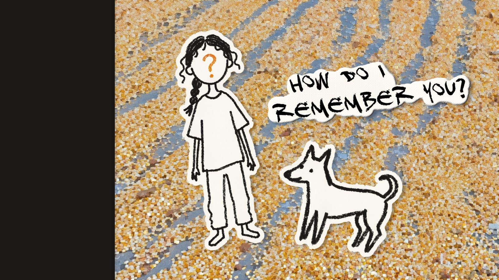
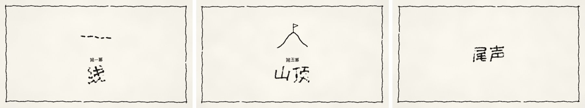
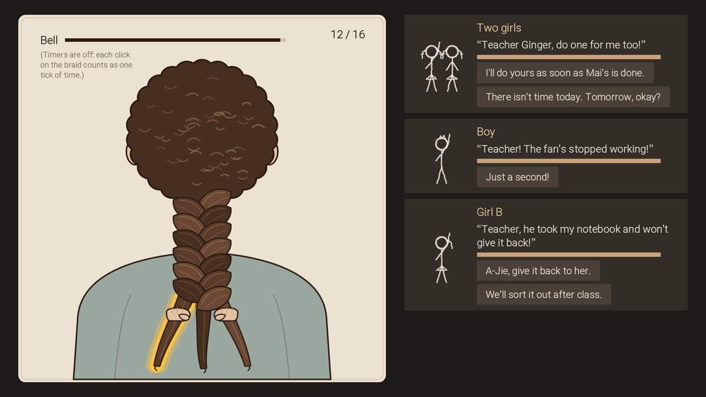
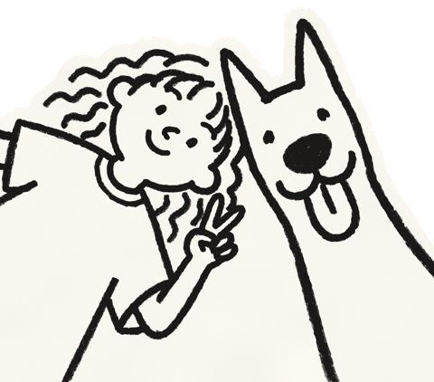

[English](README.md) · **中文**

# 我不知道该如何回忆你

*一部关于山村支教的夏天，和一个叫梅的女孩的视觉互动小说。*

### [▶ 在浏览器里直接玩](https://paprikachen.github.io/how-do-I-remember-you/)

免费 · 约 40 分钟 · 中文 / English · 使用 Ren'Py 制作

---

## 简介

大二暑假，“我”报名了学校的支教队，去山里的一所村小待一个月。出发前以为这只是一场条件艰苦些的“夏令营”。到了才知道，二十几位老师要一起在教室里打地铺。第一天傍晚，“我”在高年级的教室里遇见了**梅**：干瘦、黝黑，眼睛又圆又亮，同学们都不太愿意靠近她。

“我”想帮她。可“我”是一个三十天后就会离开的外来者，每一次出手，都要梅或者村子付出些什么。

游戏抛出两个问题，但不给答案：

- **外来者应该介入到什么程度？** 要不要记录，要不要出手，要不要说真话，离开时留下什么。
- **这些日子对我们双方究竟意味着什么？** 是全心投入、和她建立很深的关系，还是想到自己终究会回到原来的生活而保持克制？投入会让离别更伤人，克制可能让她从没感受过被认真对待。

## 玩法

- **三个内心声音。** “老师”“过客”和“摄影师”在每个关键时刻争论，没有哪一个是标准答案。
- **看不见的信任。** 屏幕上没有数值。梅怎么称呼你、会不会主动来找你、你编的辫子还在不在，都是她的回答。
- **一台不一定会用的相机。** “我”带了相机，想拍一部关于这个夏天的纪录片。拍下的画面会在结尾回放，清晰却遥远；没拍下的，只剩模糊的片段。
- **倒计时。** 右上角的小日历记着还剩几天。
- **小游戏。** 一边给梅编辫子，一边应付拉你袖子的其他学生；透过取景框构图拍照；回家后用手机和她聊天。

## 场景

背景来自一次真实支教时拍下的照片：逆光的玉米地、河湾、梅家院子里的李子树。人物用刻意简单的手绘风格。

不同的选择通向不同的告别。取决于梅有多信任你、你留给她什么，她可能追着车跑一段，可能站在村口挥手，也可能没有出来。

## 关于这个仓库

这个仓库存放的是 Ren'Py 导出的网页版，通过 GitHub Pages 发布。打开[游戏链接](https://paprikachen.github.io/how-do-I-remember-you/)即可游玩；首次启动默认英文，可在 **设置** 中切换为中文。

## 制作

编剧、摄影与设计：Paprika Chen（CS 337G 课程作品）。使用 [Ren'Py](https://www.renpy.org/) 制作。
